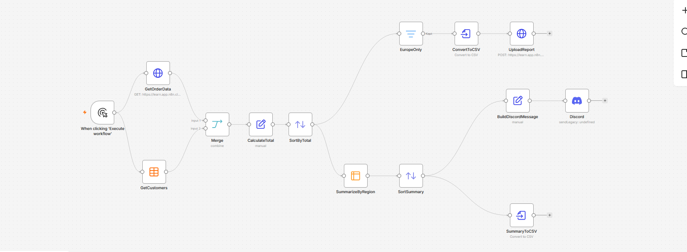

# 👋 Hi, I'm Houssam El Atifi

### n8n Automation Developer | AI Agent Enthusiast

Welcome to my portfolio! I'm learning and building workflow automation solutions using n8n, APIs, and Artificial Intelligence.

## 🚀 Skills & Technologies

- **Workflow Automation:** n8n
- **AI:** AI Agents, OpenAI
- **APIs:** REST APIs, HTTP Requests
- **Data Handling:** JSON, Data Transformation
- **Tools:** GitHub

## 📂 My Projects

### 1. Customer Service AI Agent

- Built using n8n AI Agent.
- Connected to external APIs using HTTP Request.
- Uses memory to maintain conversation context.
- Retrieves real data and answers customer questions.

*More projects coming soon!*

## 🎓 Certifications

- n8n Quickstart (QS101) – n8n Academy

## 🎯 My Goal

To build practical automation solutions that help businesses save time, improve productivity, and automate repetitive tasks.

## 📫 Contact

- GitHub: [elatifihoussam-dev](https://github.com/elatifihoussam-dev)

I'm open to learning opportunities, collaborations, and freelance automation projects.
### 2. Generating Reports Automation

- Built using n8n workflow automation.
- Retrieves order and customer data from external APIs.
- Merges and processes data to calculate totals.
- Sorts and filters reports by region.
- Converts report data into CSV files.
- Uploads generated reports using HTTP Request.
- Sends report summaries to Discord.

*This workflow helps automate report generation and data processing.*
